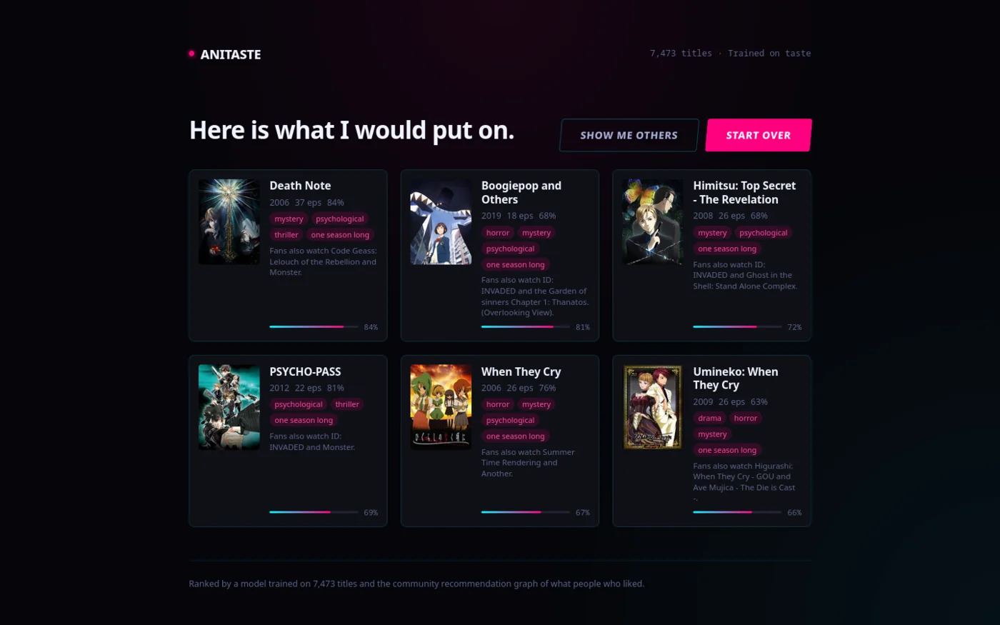
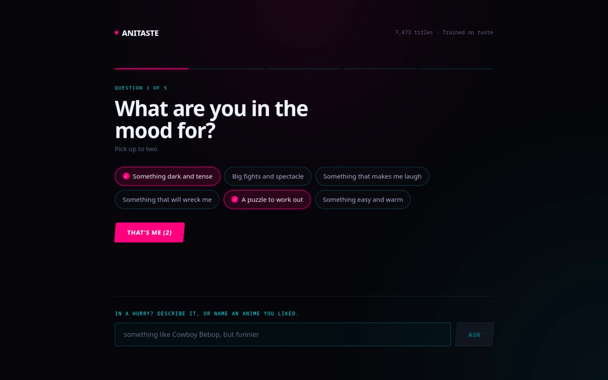
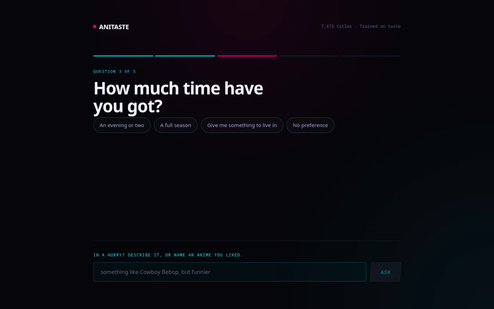
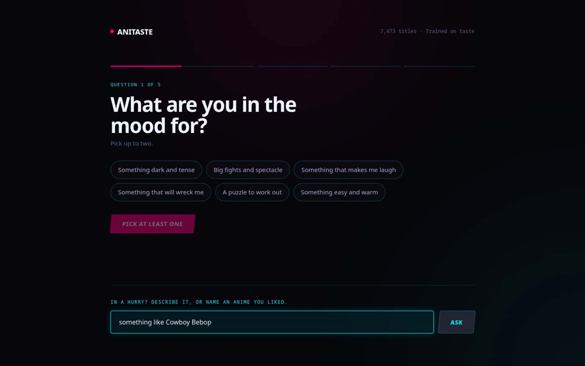
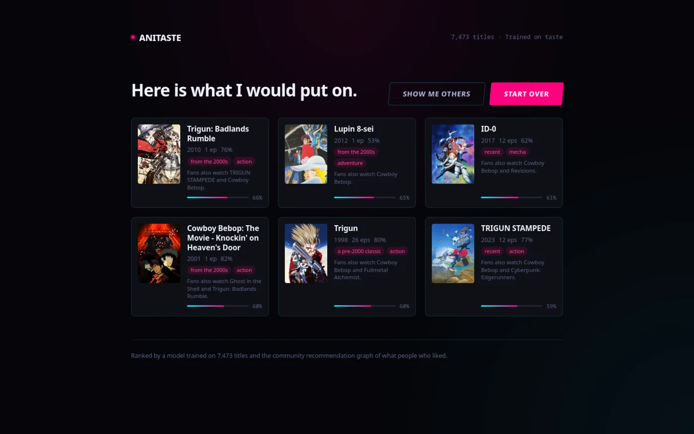

# AniTaste

AniTaste is an anime recommendations site powered by a machine learning model trained on the **community recommendation graph**.

Answer five questions, or type a sentence. It ranks ~7,500 titles and tells
you why it picked each one.

```
$ AniTaste ask "something like Cowboy Bebop"
 66%  Trigun: Badlands Rumble
      from the 2000s, action
      https://duckduckgo.com/?q=Trigun%3A+Badlands+Rumble
 65%  Lupin 8-sei
 61%  ID-0
```

Not a language model, and not a wrapper around somebody's recommendation API.
The model is trained here, from scratch, and ships as a 3 MB file.

## Screenshots



<sub>Six picks after answering the questions, each with the reason it was chosen</sub>

<table>
  <tr>
    <td width="50%"><br><sub>First question: pick up to two moods</sub></td>
    <td width="50%"><br><sub>Third question: how much time you have</sub></td>
  </tr>
  <tr>
    <td width="50%"><br><sub>Skip the questions and type a sentence instead</sub></td>
    <td width="50%"><br><sub>Results for &quot;something like Cowboy Bebop&quot;</sub></td>
  </tr>
</table>

---

## What is in the box

```
AniTaste/          the library
  model.py         loads the artifact and scores a request — standard library only
  recommend.py     the public API: answers in, recommendations out
  questions.py     the questionnaire, and what each answer means to the model
  text.py          tokenising, synonyms and negation
  ml/              the build step: harvest, train, export (needs numpy)
  cli.py           `AniTaste harvest | train | ask | status`
api/server.py      FastAPI: /api/questions, /api/recommend, /api/status
web/               Next.js single-page client
data/              the trained model, committed
MODEL-CARD.md      what it learned from, how, and what it cannot do
```

**Serving needs no numpy, no database and no network.** Scoring is dot
products over the standard library against a file read once and cached.

---

## Run it

Two processes: the Python API, and the Next.js client that proxies to it.

```bash
python -m venv .venv && . .venv/bin/activate
pip install -r requirements.txt
uvicorn api.server:app --port 8770
```

```bash
cd web
npm install
npm run dev          # http://localhost:3000
```

The client calls its own origin; `web/next.config.mjs` rewrites `/api/*` to
the Python service, so there is no CORS to configure and no API URL in the
browser bundle. Point it elsewhere with `ANITASTE_API`.

### Command line only

```bash
pip install -e .
anitaste status
anitaste ask "a short dark thriller"
```

---

## How it works, briefly

Two stages, both offline. `MODEL-CARD.md` has the full account.

**Stage 1 — where each title sits.** Build the co-occurrence matrix of the
community "if you liked X, try Y" graph, convert it to PPMI, and take a
truncated SVD. Levy and Goldberg (2014) showed skip-gram with negative
sampling is implicitly factorising a shifted PPMI matrix, so this reaches the
same objective directly — no learning rate, no epochs, same answer every run.
The SVD is the randomised range finder of Halko, Martinsson and Tropp (2011),
which turns minutes into seconds.

**Stage 2 — reaching that space with words.** Ridge regression from TF-IDF
content features (genres, community tags, synopsis, title words, era, length)
onto the stage 1 vectors. That projects *any* bag of words — a tapped answer,
a typed sentence — into the same space.

A request is then ranked on four signals: the learned similarity, direct term
overlap, the stated facts (length, era), and a small popularity prior to break
ties. Answers under "anything to avoid" subtract; a title you named is
removed, because you have seen it.

### Measured, on held-out data

| Metric | Value | Random |
| --- | --- | --- |
| recall@10 on held-out recommendation edges | **0.259** | 0.0013 |
| description → neighbours recall@10 (end to end) | **0.177** | 0.0013 |

Roughly 190× and 130× better than chance. `anitaste status` prints these from
the shipped artifact.

---

## Retraining

```bash
pip install -r requirements-ml.txt
anitaste harvest --by-year      # ~10 min; AniList, no API key
anitaste train                  # ~1 min
```

`train` **fails** if any answer in `questions.py` names a term the trained
vocabulary does not contain — a renamed tag would otherwise turn an answer
into a silent no-op that still looks like it works.

---

## What it cannot do

Measured, not assumed:

- **English only.** `algo oscuro y psicologico` is refused.
- **Abstract emotion.** "I just went through a breakup" scores very low;
  feelings are not mapped to genres.
- **Vague input.** "im bored" returns something near-arbitrary — and says so,
  because the match percentage is absolute rather than curved to look good.

Handled, after being found broken: negation ("anything but comedy" used to
return comedies), everyday words that are not genre names ("funny", "scary"),
and plurals.

The corpus is the most-watched titles on AniList, so recommendations skew
popular, Western and English-speaking. See the biases section of the model
card.

---

## Data and credits

Trained on public metadata from [AniList](https://anilist.co), which needs no
API key. **No personal data of any kind** — no accounts, no watch histories,
no identifiers. Every edge is an aggregate vote count AniList publishes
openly. The harvester identifies itself and respects the rate limit. The
corpus is a build input and is not redistributed; only the trained artifact
is committed.

Cover art is served from AniList's CDN and linked, not copied. Clicking a
result searches the web for the title; the AniList entry is in the payload as
`anilistUrl` for anyone who wants it.
